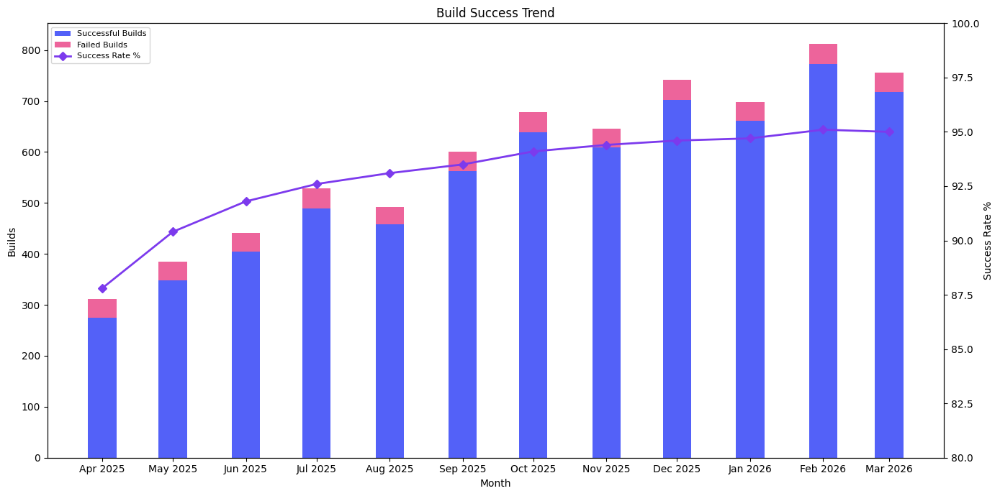

# Build Success Trend

This report shows monthly build health across the organization. It answers "is our build reliability improving over time?" and helps you spot failure spikes after CLI upgrades or when new repos come on board.

## Data Source

This report uses trace data produced by `mod build` (or later). Build-stage traces record the outcome of each build attempt. The query reads `traces` directly, so you can copy the file and run it. It filters on the command `type` it needs. The columns are already typed, so there are no casts. (Build columns appear on every command that runs a build, so the query spans those types and counts each build once with `COUNT(DISTINCT buildid)`.)

The [trace.csv reference](https://docs.moderne.io/user-documentation/moderne-cli/references/trace-csv) describes every column.

## What This Report Shows

The report gives a monthly view of build reliability with five metrics:

| Metric | Description |
|--------|-------------|
| **Total Builds** | All build attempts |
| **Successful Builds** | Builds that completed successfully |
| **Failed Builds** | Builds that failed or errored |
| **Success Rate %** | Percentage of builds that succeeded |
| **Unique Repos** | Distinct repositories with build attempts |

## Suggested Visualization

Try a stacked bar chart (successful vs. failed builds) with a line overlay for success rate percentage on a secondary y-axis.

See [build-success-trend.ipynb](../../dashboards/jupyter/build-success-trend.ipynb) for a ready-to-run Jupyter notebook that produces this visualization from [sample data](build-success-trend-sample-data.csv).

## Trace.csv Fields Used

| Field | Stage | Purpose |
|-------|-------|---------|
| `buildStartTime` | Build | Time axis, grouped by month |
| `buildId` | Build | Count distinct for build totals |
| `buildOutcome` | Build | Categorize success vs. failure |
| `path` | Common | Count distinct for unique repos |

## Example Output

| month | total_builds | successful_builds | failed_builds | success_rate_pct | unique_repos |
|-------|-------------|-------------------|---------------|------------------|--------------|
| 2026-01-01 | 698 | 661 | 37 | 94.7 | 358 |
| 2026-02-01 | 812 | 772 | 40 | 95.1 | 402 |
| 2026-03-01 | 756 | 718 | 38 | 95.0 | 384 |

## Usage

Run `build-success-trend.sql` against your `traces` table. The SQL is written in Trino syntax. For BigQuery, see [querying on BigQuery](../../data-layer/bigquery/README.md#2-query).

The query has no date filter, so it scans every partition. Once you have a lot of history, add `AND year = '2026'` (or a range like `year IN ('2026','2027')`) to narrow the scan. Both engines bill by bytes read. See the performance notes for [Athena](../../data-layer/athena/README.md#performance) and [BigQuery](../../data-layer/bigquery/README.md#performance).

Replace `'month'` in the `DATE_TRUNC` calls with `'week'`, `'quarter'`, or `'year'` to change the time granularity.
