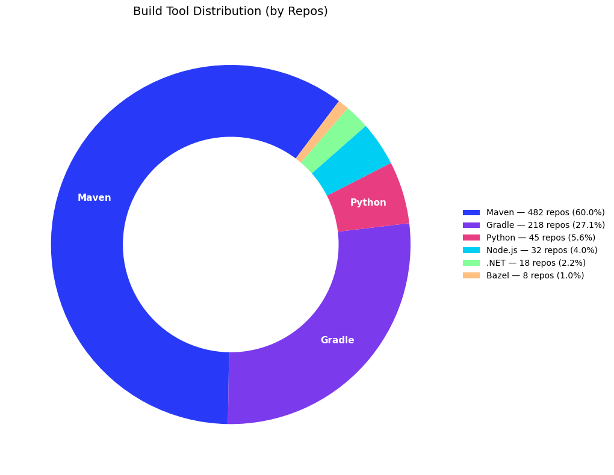
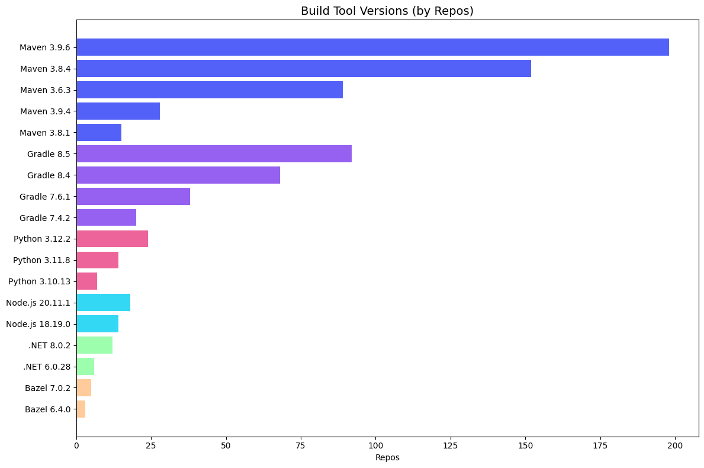

# Build Tool & Language Distribution

This report shows the distribution of build tools and versions across successfully built repositories. It answers "what does our technology landscape look like?" and helps you plan migrations (e.g., how many repos are still on Maven 3.6?).

## Data Source

This report uses trace data produced by `mod build` (or later). Build-stage traces record which build tool and version was used for each repository. The query reads `traces` directly, so you can copy the file and run it. It filters on the command `type` it needs. The columns are already typed, so there are no casts. (Build columns appear on every command that runs a build, so the query spans those types and counts each build once with `COUNT(DISTINCT buildid)`.)

The [trace.csv reference](https://docs.moderne.io/user-documentation/moderne-cli/references/trace-csv) describes every column.

## What This Report Shows

### Build Tool Summary

| Metric | Description |
|--------|-------------|
| **Build Tool** | Maven, Gradle, Bazel, .NET, Python, Node.js, or Other |
| **Repos** | Distinct repositories successfully built with this tool |
| **Builds** | Total successful build operations with this tool |

### Version Breakdown

The same metrics broken down by specific tool version (e.g., Maven 3.9.6, Gradle 8.5).

## Suggested Visualization

Use a pie or donut chart for build tool distribution, with a grouped horizontal bar chart for version breakdown within each tool.

See [build-tool-distribution.ipynb](../../dashboards/jupyter/build-tool-distribution.ipynb) for a ready-to-run Jupyter notebook that produces these visualizations from sample data ([summary](build-tool-summary-sample-data.csv), [versions](build-tool-versions-sample-data.csv)).

## Trace.csv Fields Used

| Field | Stage | Purpose |
|-------|-------|---------|
| `buildOutcome` | Build | Filter to successful builds |
| `buildMavenVersion` | Build | Detect Maven and its version |
| `buildGradleVersion` | Build | Detect Gradle and its version |
| `buildBazelVersion` | Build | Detect Bazel and its version |
| `buildDotnetVersion` | Build | Detect .NET and its version |
| `buildPythonVersion` | Build | Detect Python and its version |
| `buildNodeVersion` | Build | Detect Node.js and its version |
| `path` | Common | Count distinct for repos |
| `buildId` | Build | Count distinct for builds |

## Example Output: Build Tool Summary

| build_tool | repos | builds |
|------------|-------|--------|
| Maven | 482 | 1248 |
| Gradle | 218 | 612 |
| Python | 45 | 98 |

## Example Output: Version Breakdown

| build_tool | tool_version | repos | builds |
|------------|-------------|-------|--------|
| Maven | 3.9.6 | 198 | 512 |
| Maven | 3.8.4 | 152 | 398 |
| Gradle | 8.5 | 92 | 258 |

## Usage

Run `build-tool-distribution.sql` against your `traces` table. The file contains two queries:

1. Build Tool Summary returns one row per build tool with repo and build counts.
2. Version Breakdown returns one row per tool version.

The SQL is written in Trino syntax. For BigQuery, see [querying on BigQuery](../../data-layer/bigquery/README.md#2-query).

The queries have no date filter, so they scan every partition. Once you have a lot of history, add `AND year = '2026'` (or a range like `year IN ('2026','2027')`) to narrow the scan. Both engines bill by bytes read. See the performance notes for [Athena](../../data-layer/athena/README.md#performance) and [BigQuery](../../data-layer/bigquery/README.md#performance).
