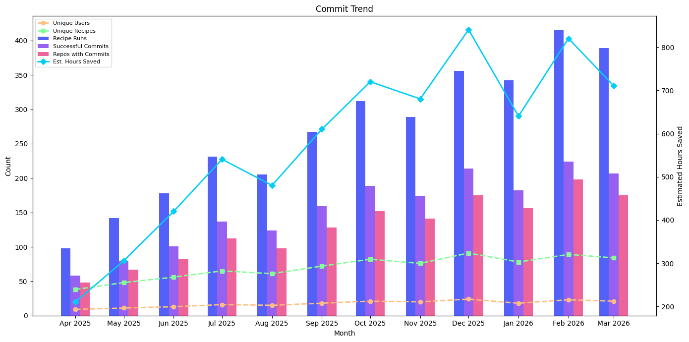

# Commit Trend

This is the broadest trend view. It lines recipe runs up against what actually got committed, month by month, and answers "are more runs leading to more real commits?"

## Data Source

This report uses trace data produced by `mod git commit` (or later). Commit-stage traces include everything from the run through the commit, so recipe activity and committed output sit side by side. The query reads `traces` directly, so you can copy the file and run it. It filters on the command `type` it needs. The columns are already typed, so there are no casts.

The [trace.csv reference](https://docs.moderne.io/user-documentation/moderne-cli/references/trace-csv) describes every column.

## What This Report Shows

The report gives a monthly view of seven metrics:

| Metric | Description |
|--------|-------------|
| **Commit Jobs** | Total commit operations performed |
| **Recipe Runs** | Total recipe executions that led to commits |
| **Unique Users** | Distinct users who committed recipe changes |
| **Unique Recipes** | Distinct recipes that produced commits |
| **Repos with Commits** | Distinct repositories that received committed changes |
| **Successful Commits** | Commit operations that completed successfully |
| **Estimated Hours Saved** | Total estimated developer time saved by committed changes |

## Suggested Visualization

Try a multi-series bar/line chart with a shared monthly time axis. Use bars for volume metrics (commit jobs, recipe runs) and line overlays for unique counts (users, recipes, repos). Hours saved works well as a secondary y-axis.

See [commit-trend.ipynb](../../dashboards/jupyter/commit-trend.ipynb) for a ready-to-run Jupyter notebook that produces this visualization from [sample data](commit-trend-sample-data.csv).

## Trace.csv Fields Used

| Field | Stage | Purpose |
|-------|-------|---------|
| `commitStartTime` | Commit | Time axis, grouped by month |
| `commitId` | Commit | Count distinct for commit jobs |
| `commitOutcome` | Commit | Filter and count successful commits |
| `runId` | Run | Count distinct for recipe runs |
| `runRecipeId` | Run | Count distinct for unique recipes |
| `developer` | Common | Count distinct for unique users |
| `path` | Common | Count distinct for repos with commits |
| `runEstimatedEffortTimeSavingsMs` | Run | Sum for estimated hours saved |

## Example Output

| month | commit_jobs | recipe_runs | unique_users | unique_recipes | repos_with_commits | successful_commits | estimated_hours_saved |
|-------|-------------|-------------|--------------|----------------|--------------------|--------------------|----------------------|
| 2026-01-01 | 189 | 342 | 18 | 24 | 156 | 182 | 640.5 |
| 2026-02-01 | 231 | 415 | 23 | 29 | 198 | 224 | 820.3 |
| 2026-03-01 | 214 | 389 | 21 | 26 | 175 | 207 | 710.8 |

## Usage

Run `commit-trend.sql` against your `traces` table. The SQL is written in Trino syntax. For BigQuery, see [querying on BigQuery](../../data-layer/bigquery/README.md#2-query).

The query has no date filter, so it scans every partition. Once you have a lot of history, add `AND year = '2026'` (or a range like `year IN ('2026','2027')`) to narrow the scan. Both engines bill by bytes read. See the performance notes for [Athena](../../data-layer/athena/README.md#performance) and [BigQuery](../../data-layer/bigquery/README.md#performance).

Replace `'month'` in the `DATE_TRUNC` calls with `'week'`, `'quarter'`, or `'year'` to change the time granularity.
