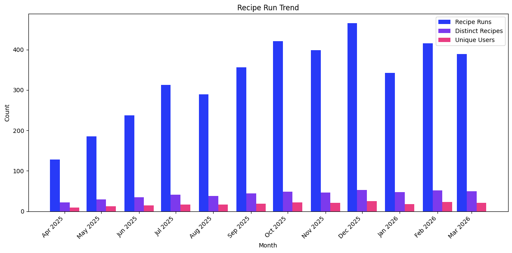

# Recipe Run Trend

This report tracks Moderne adoption month by month, so you can see whether usage is growing.

## Data Source

This report uses trace data produced by `mod run`. Any later-stage command (`mod git apply`, `mod git commit`, `mod git push`) also includes run-stage data and will work with this query. The query reads `traces` directly, so you can copy the file and run it. It filters on the command `type` it needs. The columns are already typed, so there are no casts.

The [trace.csv reference](https://docs.moderne.io/user-documentation/moderne-cli/references/trace-csv) describes every column.

## What This Report Shows

The report gives a monthly (or weekly) view of three adoption metrics:

| Metric | Description |
|--------|-------------|
| **Recipe Runs** | Total number of recipe executions per period |
| **Distinct Recipes** | Number of unique recipes used per period |
| **Unique Users** | Number of distinct users running recipes per period |

## Suggested Visualization

Try a grouped bar chart with three series (one per metric) on a shared time axis. Alternatively, a multi-line chart works well for spotting trends across longer time ranges.

See [recipe-run-trend.ipynb](../../dashboards/jupyter/recipe-run-trend.ipynb) for a ready-to-run Jupyter notebook that produces this visualization from [sample data](recipe-run-trend-sample-data.csv).

## Trace.csv Fields Used

| Field | Stage | Purpose |
|-------|-------|---------|
| `runStartTime` | Run | Time axis, grouped by month or week |
| `runId` | Run | Count distinct for total recipe runs |
| `runRecipeId` | Run | Count distinct for unique recipes |
| `developer` | Common | Count distinct for unique users |
| `runOutcome` | Run | Filter to rows that reached the run stage |

## Example Output

| month | recipe_runs | distinct_recipes | unique_users |
|-------|-------------|------------------|--------------|
| 2026-01-01 | 342 | 47 | 18 |
| 2026-02-01 | 415 | 52 | 23 |
| 2026-03-01 | 389 | 49 | 21 |

## Usage

Run `recipe-run-trend.sql` against your `traces` table. The SQL is written in Trino syntax. For BigQuery, see [querying on BigQuery](../../data-layer/bigquery/README.md#2-query).

The query has no date filter, so it scans every partition. Once you have a lot of history, add `AND year = '2026'` (or a range like `year IN ('2026','2027')`) to narrow the scan. Both engines bill by bytes read. See the performance notes for [Athena](../../data-layer/athena/README.md#performance) and [BigQuery](../../data-layer/bigquery/README.md#performance).

Replace `'month'` in the `DATE_TRUNC` calls with `'week'`, `'quarter'`, or `'year'` to change the time granularity.
