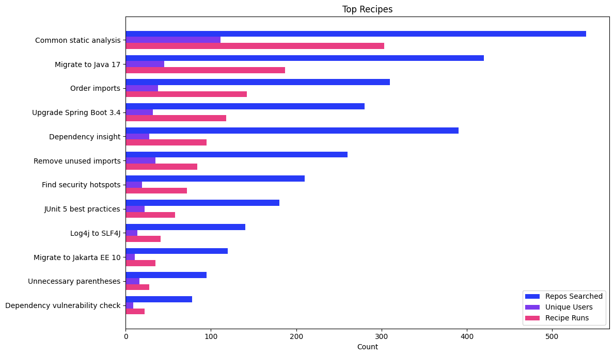

# Top Recipes

This report ranks the most-used recipes by run count and unique users.

## Data Source

This report uses trace data produced by `mod run`. Any later-stage command (`mod git apply`, `mod git commit`, `mod git push`) also includes run-stage data and will work with this query. The query reads `traces` directly, so you can copy the file and run it. It filters on the command `type` it needs. The columns are already typed, so there are no casts.

The [trace.csv reference](https://docs.moderne.io/user-documentation/moderne-cli/references/trace-csv) describes every column.

## What This Report Shows

The report gives a ranked list of recipes sorted by total runs, with three metrics per recipe:

| Metric | Description |
|--------|-------------|
| **Recipe Runs** | Total number of times the recipe was executed |
| **Unique Users** | Number of distinct users who ran the recipe |
| **Repos Searched** | Total repositories the recipe was run against |

## Suggested Visualization

Try a treemap sized by recipe runs with color intensity by unique users. Alternatively, a horizontal bar chart sorted by run count works well for a simpler view.

See [top-recipes.ipynb](../../dashboards/jupyter/top-recipes.ipynb) for a ready-to-run Jupyter notebook that produces this visualization from [sample data](top-recipes-sample-data.csv).

## Trace.csv Fields Used

| Field | Stage | Purpose |
|-------|-------|---------|
| `runRecipeId` | Run | Recipe identifier, the grouping key |
| `runRecipeInstanceName` | Run | Human-readable recipe name |
| `runId` | Run | Count distinct for total recipe runs |
| `developer` | Common | Count distinct for unique users |
| `path` | Common | Count distinct for repos searched |
| `runOutcome` | Run | Filter to rows that reached the run stage |

## Example Output

| recipe_id | recipe_name | recipe_runs | unique_users | repos_searched |
|-----------|-------------|-------------|--------------|----------------|
| org.openrewrite.java.OrderImports | Order imports | 303 | 111 | 2450 |
| org.openrewrite.java.migrate.UpgradeToJava17 | Migrate to Java 17 | 187 | 45 | 1820 |
| org.openrewrite.staticanalysis.CommonStaticAnalysis | Common static analysis | 142 | 38 | 1200 |

## Usage

Run `top-recipes.sql` against your `traces` table. The SQL is written in Trino syntax. For BigQuery, see [querying on BigQuery](../../data-layer/bigquery/README.md#2-query).

The query has no date filter, so it scans every partition. Once you have a lot of history, add `AND year = '2026'` (or a range like `year IN ('2026','2027')`) to narrow the scan. Both engines bill by bytes read. See the performance notes for [Athena](../../data-layer/athena/README.md#performance) and [BigQuery](../../data-layer/bigquery/README.md#performance).

Results are sorted by recipe runs descending. Add a `LIMIT` clause to show only the top N recipes (e.g., `LIMIT 20`).
