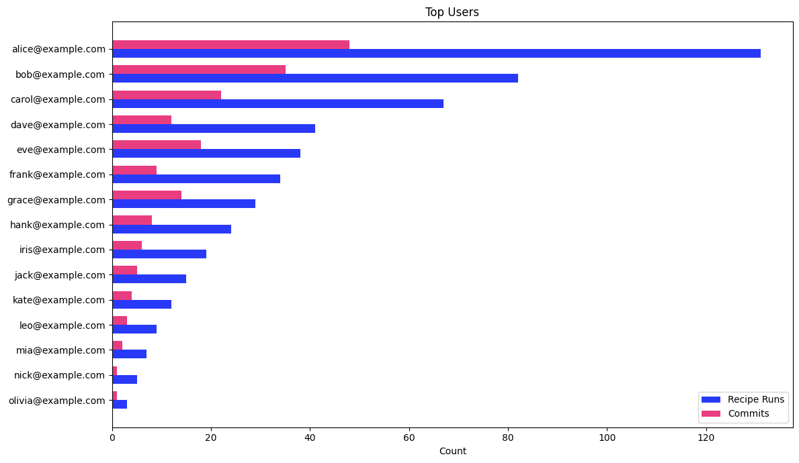

# Top Users

This report ranks users by recipe runs and commits, so you can see who your power users and champions are.

## Data Source

This report uses trace data produced by `mod git commit` (or later). Commit-stage traces include both run and commit data for each user. The query reads `traces` directly. Run metrics come from `type = 'run'` rows and commit metrics come from `type = 'commit'` rows. The query counts them separately and joins the results, so a re-emitted stage can't inflate the totals. The columns are already typed, so there are no casts.

If there are no commit traces yet, recipe-run counts are still accurate and commit counts are zero.

The [trace.csv reference](https://docs.moderne.io/user-documentation/moderne-cli/references/trace-csv) describes every column.

## What This Report Shows

The report gives a ranked list of users sorted by activity level, with two metrics per user:

| Metric | Description |
|--------|-------------|
| **Recipe Runs** | Total number of recipe executions by the user |
| **Commits** | Number of repositories the user successfully committed recipe changes to |

## Suggested Visualization

Try a dual horizontal bar chart with one series for recipe runs and one for commits, sorted descending by recipe runs. Expect a long tail, with a few power users accounting for most of the activity.

See [top-users.ipynb](../../dashboards/jupyter/top-users.ipynb) for a ready-to-run Jupyter notebook that produces this visualization from [sample data](top-users-sample-data.csv).

## Trace.csv Fields Used

| Field | Stage | Purpose |
|-------|-------|---------|
| `developer` | Common | User identifier (email) |
| `runId` | Run | Count distinct for total recipe runs |
| `runOutcome` | Run | Filter to rows that reached the run stage |
| `commitOutcome` | Commit | Filter to successful commits |

## Example Output

| developer | recipe_runs | commits |
|-----------|-------------|---------|
| alice@example.com | 131 | 48 |
| bob@example.com | 82 | 35 |
| carol@example.com | 67 | 22 |
| dave@example.com | 41 | 12 |

## Usage

Run `top-users.sql` against your `traces` table. The SQL is written in Trino syntax. For BigQuery, see [querying on BigQuery](../../data-layer/bigquery/README.md#2-query).

The query has no date filter, so it scans every partition. Once you have a lot of history, add `AND year = '2026'` (or a range like `year IN ('2026','2027')`) to narrow the scan. Both engines bill by bytes read. See the performance notes for [Athena](../../data-layer/athena/README.md#performance) and [BigQuery](../../data-layer/bigquery/README.md#performance).

Results are sorted by recipe runs descending. Add a `LIMIT` clause to show only the top N users (e.g., `LIMIT 20`).
